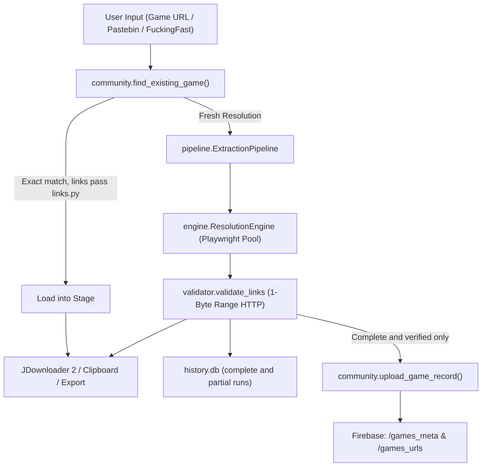

# MEMORY.md — FitGirl Direct Link Extractor AI Agent Context & Knowledge Base

> **AI Memory Persistence Document**: This file serves as the continuous long-term memory for AI coding assistants (Antigravity, Claude Code, Cursor, Copilot Workspace) working on this codebase. It documents architectural decisions, solved technical gotchas, domain constraints, and active roadmap status to eliminate AI amnesia across development sessions.

---

## 1. Project Overview & Identity

* **Project Name**: FitGirl Direct Link Extractor (`Link-Extractor`)
* **Repository**: [https://github.com/vik05h/Link-Extractor](https://github.com/vik05h/Link-Extractor)
* **Author / Maintainer**: Vikash (@vik05h)
* **License**: **PolyForm Noncommercial License 1.0.0** (and Creative Commons BY-NC-SA 4.0).
  * **Rule**: Strictly non-commercial (no sales, paywalls, adware, or monetized forks).
  * **Rule**: Mandatory author attribution in all UIs, documentation, and source distributions.

---

## 2. Technology Stack & Runtime Dependencies

| Component | Technology | Purpose |
| :--- | :--- | :--- |
| **GUI Framework** | Astro 5 + Svelte 5 + WebView2 (`pywebview`) | Hardware-accelerated desktop web UI with Living Canvas, Defrag Mosaic, and Apple Liquid Glass design (migrated from legacy Flet in v3.8.0) |
| **Automation Engine** | `playwright` (async) | Headless/Headed Chromium & Edge worker pool for JS decryption |
| **HTML Parsing** | Regular expressions in `scraper.py` | Extraction of pastebin links and game titles |
| **Local Storage** | `sqlite3` | Persistent local extraction history and fast search |
| **Integration** | `urllib`, `pyperclip` | JDownloader 2 Click'n'Load / FlashGot API & clipboard automation |
| **Packaging** | `pyinstaller` (6.21+) | Standalone single-file Windows executable generation |

---

## 3. Architecture & Dataflow

---

## 4. Solved Technical Gotchas & Critical Traps

### Packaging and desktop shell

* **PyInstaller %TEMP% wipe**: Single-file binaries unpack into `%TEMP%/_MEIxxxxxx` and delete it on exit. All persistent state uses `get_app_data_dir()`, which resolves to `%APPDATA%\FitGirlLinkExtractor\` when frozen.
* **PyInstaller and pywebview**: `pythonnet` C-extensions and WebView2 bindings need `collect_all('webview')`, `collect_all('pythonnet')`, and `collect_all('clr_loader')`, alongside `('dist_web', 'dist_web')` in `datas`.
* **pywebview private mode**: `webview.start()` defaults to `private_mode=True`, which wipes `localStorage` on exit. Always pass `private_mode=False`.
* **Local assets**: `file://` breaks the Web Audio context and root-relative asset URLs. Always pass `http_server=True`.
* **JS API reflection recursion**: pywebview reflects every public attribute of the API object into JavaScript and recursed through WinForms and COM objects when given `self.window`. Keep internal references private (`self._window`).
* **Off-screen headed browser**: A visible browser steals foreground focus and Windows throttles the app's rendering. Chromium launches with `--window-position=-3000,-3000`.
* **Dynamic export directory**: Hardcoded `C:\Users\...` breaks on other drive layouts. Use `get_export_dir()` and `open_folder_cross_platform()`.

### Trusting shared data

* **The database has no login**: Anyone can send requests to Firebase directly, so client checks protect only the client. Server protection lives in `firebase/database.rules.json`, and client checks in `links.py` and `game_records.clean_feed_record()`. Both must agree, which `tests/test_firebase_rules_static.py` checks.
* **Substring host checks**: `"fuckingfast.co" in url` accepted `https://evil.example/fuckingfast.co/setup.exe`. Compare parsed hostnames through `links.py`.
* **A clickable source_url is a script risk**: A `javascript:` link in `<a href>` runs with access to the bridge, even with no `{@html}` in the frontend. `clean_feed_record()` drops records whose source host is not allowed.
* **Clients must never delete games**: An older "Intelligent Canonical Deduplication" compared the first 24 letters of titles and sent DELETE requests. It removed real games such as Modern Warfare II versus III. `dedupe_feed()` now only hides repeats from display.
* **Admin rights live on the server**: An older passkey was checked against a local file or environment variable, so any user could become admin. The key is now the Firebase database secret, sent with each change for the server to judge. It must never reach logs or settings.
* **Old data shapes**: About 72 records from old versions have the title `FuckingFast Direct Parts` and a blob of links as `source_url`. They stay in the database and are hidden from the Hub.

### Pipeline results

* **What may be saved and published**: `pipeline.py` is the single place that decides. Cancelled runs keep nothing. Partial runs are saved locally with `resolved_count < total_parts`, and are never published or offered as a cached match.
* **Validator verdicts**: `dead` means the server said the file is gone, including a 200 HTML page. `unknown` means a timeout, 429, or 5xx, so the link is kept but the run does not count as verified. Throwing away unknown links would lose minutes of work to a network hiccup.
* **Part names must match across the bridge**: The frontend matches progress events by filename, so `pipeline.py` and `engine.py` both use `links.part_name()`.

### Community feed

* **Feed update loop**: `community:feed_updated` must trigger a non-forced refresh. A forced one starts a new sync, which fires the event again, forever.
* **Cost**: `games_meta` is about 550 KB and Firebase ignores gzip on this API. Stats and heartbeats must read the cached list and never trigger a download.
* **Local reports never override the server**: A local copy is only an outbox. It used to overwrite the status and remark from the server, so reporters never saw replies.
* **Presence path**: Presence lives at `games_meta/grand-theft-auto-v/presence` because the live rules grew around it. Uploads use PATCH so they do not wipe it, and `clean_feed_record()` strips it from the feed.

### Updater

* **PyInstaller relaunch**: A one-file exe started from the old process's environment looks for the deleted temp folder. The update script sets `PYINSTALLER_RESET_ENVIRONMENT=1`.
* **Truncated downloads pass silently**: `http.client` returns short reads without raising, so `download_update()` compares the byte count itself, plus size, SHA-256 (from the `digest` field in the GitHub API), and the `MZ` header.
* **A self-deleting batch file**: Plain `del "%~f0"` makes cmd report an error. Use `(goto) 2>nul & del "%~f0"`.

### Liquid Glass and startup

* **Real refraction**: Chromium runs SVG filters in `backdrop-filter`, so `use:liquidGlass` builds a displacement map per surface shape. Surfaces of the same shape share one filter, which is why hundreds of game cards cost one map.
* **Glass needs something behind it**: The bars used to sit beside the content over a blurred gradient, so there was nothing to bend. Content now runs the full height and scrolls beneath them, which is why `--deck-offset` exists and views add it as top padding.
* **Backdrop Root**: A `backdrop-filter`, `filter`, `mask`, or opacity below 1 on an ancestor limits what a surface can sample. This is why dialog scrims have no blur, fade their background color, and why cards themselves carry no `backdrop-filter`.
* **Cost**: `content-visibility: auto` on cards keeps off-screen ones from doing work, and their ResizeObserver only fires once they are near the screen. Avoid `will-change` on cards, which would make a layer for each of hundreds.
* **Slow PCs**: `watchGlassPerformance()` drops to frosted glass for the session if frames run slow. A choice in Settings overrides it.
* **The splash always ends**: `utils/boot.ts` has a hard time limit, and a slow image host or crash only shortens what gets preloaded. The HTTP cache is disabled in `main.py`, so preloaded covers are kept referenced until the Hub shows them.
* **Measure before the reveal**: `.is-booting` hides things with opacity alone, because the splash measures the URL bar and sidebar logo to morph into them. A transform there would make it land in the wrong place.
* **A bar's bubble lives beside the bar**: The bar's own `backdrop-filter` makes it a Backdrop Root, so a bubble inside it could only see the bar. `utils/glassBubble.ts` appends the bubble to a host element (the app root, or the sticky tab row) and positions it over the selected item. That is also why the sidebar's bubble has its own `.is-booting` and reveal rules.
* **A short bubble needs a gentle rim**: On a 30 px capsule, a full rim bend pulls copies of the label to its edges. `liquidGlass.ts` caps the bend at a share of the height for the bubble and for its lens.
* **The tour's sample game**: While the tour is open, MainApp shows `utils/sampleGame.ts` on the Stage with `demo` set, so Push, Copy and Export do nothing, the filter chips leave the saved choice alone, and the real game and any running extraction carry on underneath. The sample starts resolving when the tour first opens the Stage, so its blocks are still lighting up there.
* **The tour plays once**: `utils/launch.ts` treats a profile with no `le_first_run_*` key as a new install. When the tour opens by itself it sets `le_tour_completed` at once, so quitting halfway does not replay it. Any earlier `le_first_run_*` key means an update, which opens What's New instead.

### Wording and frontend tests

* **Two voices**: GenZ by default, classic from Settings. Lines in the tour, splash, success pop-ups, empty screens, the clipboard pop-up and the top of What's New go through `utils/voice.ts`, and `tests/voice.test.ts` keeps both voices complete with matching placeholders. Errors, warnings, update, safety and delete messages, dialogs that ask for a choice, buttons, Settings and the Issue Center stay plain.
* **Node runs the frontend tests by stripping types**: modules under `frontend/src/utils/` that tests import cannot use TypeScript-only syntax such as constructor parameter properties or enums.

### Names that drift

* **Wrong names hidden by broad excepts**: Several past bugs were a wrong function or attribute name swallowed by `except Exception`, such as `validate_single_link` and `total_size_bytes`. `ruff` (BLE rules) and `pyright` in CI catch this class, and `tests/test_contracts.py` checks bridge methods and events against the frontend. Catch specific exceptions, and log anything caught broadly.

---

## 5. Security Baseline

Security checks run against real app code as part of `python -m pytest`, offline:

* **Link trust**: `tests/test_links.py`, and `tests/test_community.py` for shared records.
* **Moderation**: `tests/test_issues.py`.
* **What the page may trigger** (SSRF, settings, updates): `tests/test_bridge.py`.
* **Update safety**: `tests/test_updater.py`.
* **SQL injection**: `tests/test_history.py`.
* **Path traversal, slowdowns from hostile input, secrets**: `tests/test_security.py`.
* **Crawljob injection**: `tests/test_integrations.py`.
* **Database rules**: `tests/test_firebase_rules.py`, on the Firebase emulator.

---

## 6. Project Roadmap & Milestone Tracker

- [x] **Phase 1: High-Speed Direct Resolver** (Multi-tab Playwright concurrency, exponential backoff).
- [x] **Phase 2: Modern Material 3 UI & Suite** (Flet M3, SQLite archive, JD2 push, EXE packaging).
- [x] **Phase 3: Community Cloud Cache & Shared Link Hub** (Firebase Realtime DB REST API, Pixel Dino loading animation, 3D game cards, local timezone intelligence, instant pre-fetched resolver).
- [x] **Phase 4: Next-Gen Gaming Hub UI/UX Overhaul** (Astro + Svelte, pywebview, Living Canvas, Defrag Mosaic, Selective Bandwidth Saver, Clipboard Sentinel, Audio Haptics).

---

## 7. AI Agent Guidelines for Future Work

1. **Always Maintain Author Credit**: Vikash (@vik05h) must remain in all legal/UI headers.
2. **Never Hardcode System Paths**: Always use `get_app_data_dir()`, `get_resource_path()`, or `get_export_dir()`.
3. **Verify Build Correctness**: When modifying GUI or dependencies, re-verify with `pyinstaller LinkExtractor_Single.spec --noconfirm`. Add new modules to `hiddenimports` in the spec files.
4. **Preserve Cancellation Integrity**: Aborted extractions must never be persisted to `history.db`.
5. **No Emojis in Documentation or UI**: Maintain professional, clean typography across all documentation files and UI labels/buttons. Use SVG components (`<Icon />`) instead of Unicode emojis in frontend components.
6. **Run the Checks**: `python -m pytest`, `ruff check .`, `pyright`, and `npm run check` and `npm test` in `frontend/`. After changing `firebase/database.rules.json`, also run the emulator tests described in `firebase/README.md`.
